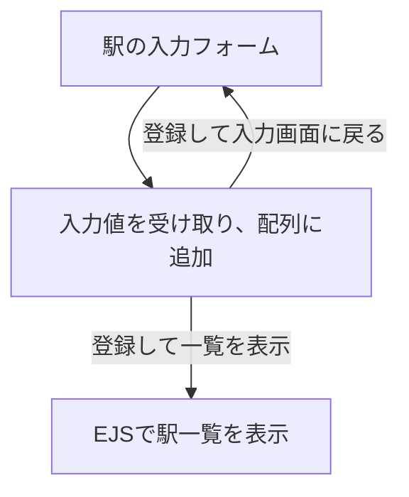

# webpro_06

## 第9回の実習：一覧と詳細表示

`node app5.js` で起動して、以下のページを開く。

- 京葉線の駅一覧（詳細つき）：<http://localhost:8080/keiyo2>
- 駅を追加するフォーム：<http://localhost:8080/public/keiyo2_add.html>

一覧の駅名を押すと、`/keiyo2/0` のようなURLで、その駅の詳細を表示する。
URLの数字は `req.params.number` で受け取り、配列の何番目のデータかを表す。
一覧では駅名で検索できる。

「駅を追加する」から、ID・駅コード・駅名・乗り換え線・乗降客数・東京駅からの距離を入力して登録する。
送信した値を `req.query` で受け取り、`/keiyo2_add` の処理で配列に追加して、一覧に戻る。
乗り換え線は空欄でも登録できる。追加分はサーバーを再起動すると消える。

レポート用に開発するシステムの設計は [report.md](report.md) にまとめた。

## 第8回の実習：データの流れ

`node app5.js` で起動して、以下のページを開く。初回は `npm install` を先に実行する。

- 京葉線の駅一覧（表）：<http://localhost:8080/keiyo>
- 京葉線の駅一覧（列挙）：<http://localhost:8080/keiyo/simple>
- 京葉線の駅の入力フォーム：<http://localhost:8080/public/keiyo_add.html>
- 体操と柔道の一覧：<http://localhost:8080/sports>

京葉線の2つの一覧は、同じ配列を `db1.ejs` で1件ずつ列挙するか、
`db2.ejs` で表にするかを切り替えた例。
入力フォームでは、登録後に一覧・入力画面・登録結果のいずれかを表示できる。
「入力内容を確認」を選ぶと、確認画面で「登録する」を押した時点で配列に追加する。



繰り返しの練習は `node lesson08-loops.js` で実行する。
同じ配列を `for`、`for...of`、`forEach` で順に表示し、配列やオブジェクトから値を取り出す例も確認できる。

体操と柔道の一覧で「種目・技を追加する」を押し、競技を選んで名前を入力する。
送信した値を `req.query` で受け取り、`push()` で配列に追加する。
登録後は一覧に戻り、EJSが配列の内容を表にする。追加分はサーバーを再起動すると消える。

## 第7回の実習：ラジオボタンのじゃんけん

[フォームの入力例](http://localhost:8080/public/form-example.html)では、
テキスト、数字、ラジオボタン、チェックボックス、範囲、年月日、年月を送信し、
`req.query` で受け取った値を確認できる。パスワード欄は文字を伏せて表示する練習用。

元の `public/janken.html`、`views/janken.ejs` と、
`app5.js` の `/janken` の処理を残して、`/janken2` を追加した。
グー・チョキ・パーから1つ選ぶと、コンピュータの手との勝敗が表示される。
続けて遊ぶと試合数が増え、勝った場合だけ勝利数が増える。
あいこも1試合として数える。

### 起動方法

このフォルダで次を実行する。

```sh
npm install
node app5.js
```

ブラウザで <http://localhost:8080/public/janken2.html> を開く。
停止するときは、ターミナルで `Control + C` を押す。
この実習では `npm start` ではなく `node app5.js` で起動する。

### 入力内容がサーバーへ届く流れ

例えば、最初にグーを選んで送信すると、次のURLへアクセスする。

```text
/janken2?hand=グー&win=0&total=0
```

実際のURLでは、日本語が `%` を含む文字列に変換されて表示される場合がある。
サーバー側では `req.query.hand` で選んだ手を受け取る。
`win` と `total` は文字列として届くので、`Number()` で数値に変換する。
結果画面の隠し入力欄に勝利数と試合数を入れ、次の送信へ引き継ぐ。
この方法はブラウザ側で数値を変えられるため、改ざんできない成績の記録には使えない。

## 課題（3）：input要素のtype・name・id

### type：入力欄の種類

`type` は、文字入力やラジオボタンなど、入力欄の種類を決める。
今回は `type="radio"` で選択肢を作り、`type="hidden"` で画面に表示しない数値を送る。
`type="submit"` はフォームを送信するボタンを作る。

### name：送信するときの項目名

`name` は、フォームの値を送るときの項目名になる。
3つのラジオボタンを同じ `name="hand"` にすると、同じグループになり、1つだけ選択できる。
選んだボタンの `value` が `hand` の値として送られる。
サーバーでは、この名前を使って `req.query.hand` で受け取る。

### id：ページ内で要素を識別する名前

`id` は、ページ内の要素を区別するために付ける。同じページ内では重複させない。
`label` の `for` と一致させると、ラベルの文字をクリックしても入力欄を選べる。
CSSやJavaScriptから特定の要素を指定するときにも使う。
`id` を付けるだけでは、フォームの送信項目名にはならない。

```html
<input type="radio" name="hand" id="gu" value="グー" required>
<label for="gu">グー</label>
```

この例では、ラジオボタンを作り、グーを選ぶと `hand=グー` として送る。
`id="gu"` と `for="gu"` は、入力欄とラベルを結び付けている。
`required` は、このグループの選択を必須にする。

## 課題（4）：HTMLファイルとEJSファイルの使い分け

HTMLは、ブラウザに表示するページの構造を記述するもの。
サーバーで値を埋め込む必要がないページは、HTMLファイルをそのまま配信できる。
今回の最初の入力画面 `public/janken2.html` は、選択肢と初期値が決まっているのでHTMLで作った。

EJSは、サーバー側でデータを埋め込んでHTMLを作るためのテンプレート。
今回の結果画面 `views/janken2.ejs` は、選んだ手・勝敗・試合数が毎回変わるのでEJSで作った。
例えば `<%= judgement %>` の場所に、サーバーで判定した「勝ち」などの文字が入る。

```js
res.render('janken2', { your: hand, cpu, judgement, win, total });
```

この処理で、データをEJSへ渡してHTMLを生成する。
ブラウザが受け取るのは、EJSの記法が処理された後のHTMLである。
HTMLにもJavaScriptを組み合わせて動きを付けられるので、HTMLなら必ず動かない、という意味ではない。
