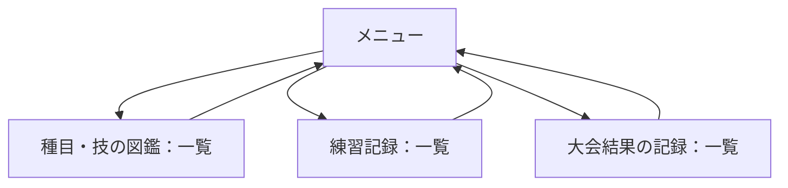
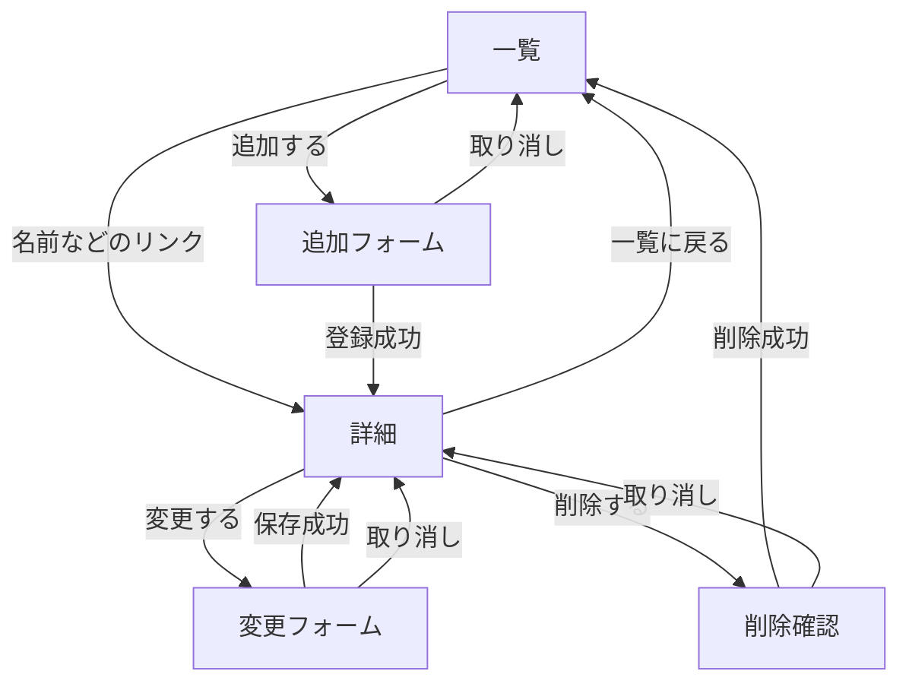
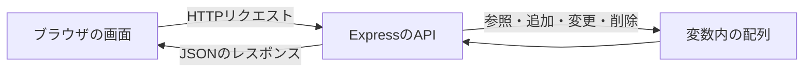

# 体操と柔道を扱う3つのWebアプリケーションの設計仕様書

作成日：2026年11月13日

第9回「やってみよう」(2)に合わせ、開発するシステムの対象、ページ遷移、スキーマをまとめる。利用者向け・管理者向け・開発者向けの3部構成とする。

**文書の状態：設計版。** 以下の3つのアプリケーションは、これから実装する内容を記したものである。実装後、実際の動作と照合して仕様書を更新する。

| アプリケーション | 目的 | 扱う項目 |
|---|---|---|
| 種目・技の図鑑 | 一覧から種目や技を選び、説明や特徴を見る | ID、競技名、種目・技名、説明、特徴 |
| 練習記録 | 練習した内容を日付ごとに記録し、振り返る | ID、日付、競技名、練習内容、回数、感想 |
| 大会結果の記録 | 大会ごとの得点や勝敗を一覧・詳細で見る | ID、大会名、日付、競技名、得点・勝敗、感想 |

3つのアプリケーションは、それぞれ専用のデータと一覧・詳細・追加・変更・削除の機能を持つ。共通メニューから選べる構成にし、競技名は「体操」「柔道」の2つから選ぶ。

## 第1部　利用者向け

### 1.1　システムの目的

体操と柔道について、種目や技の情報、日々の練習、大会での結果を分けて管理する。調べるための図鑑と、自分で記録する練習・大会結果を別のアプリケーションにすることで、目的に合う情報を探しやすくする。

画面は、授業で使用した見出し、表、リンク、入力フォームを基本にする。一覧には探すための項目を表示し、長い説明や感想は詳細画面に表示する。

### 1.2　種目・技の図鑑

一覧にはID、競技名、種目・技名を表示する。名前のリンクを押すと、その種目・技の説明と特徴を確認できる。

新しく登録するときは、競技名、種目・技名、説明、特徴を入力する。登録済みの内容は、詳細画面の「変更する」から修正できる。削除するときは、対象の名前が表示された確認画面で「削除する」を押す。

| 画面 | 表示・入力する内容 |
|---|---|
| 一覧 | ID、競技名、種目・技名、詳細へのリンク |
| 詳細 | ID、競技名、種目・技名、説明、特徴 |
| 追加・変更 | 競技名、種目・技名、説明、特徴 |
| 削除確認 | ID、競技名、種目・技名、削除の実行と取り消し |

### 1.3　練習記録

一覧にはID、日付、競技名、練習内容を表示する。練習内容のリンクを押すと、回数と感想も確認できる。

登録するときは、練習した日付、競技名、練習内容、回数、感想を入力する。回数は1以上の整数とし、感想は空欄でも登録できる。内容を間違えた場合は、詳細画面から変更または削除する。

| 画面 | 表示・入力する内容 |
|---|---|
| 一覧 | ID、日付、競技名、練習内容、詳細へのリンク |
| 詳細 | ID、日付、競技名、練習内容、回数、感想 |
| 追加・変更 | 日付、競技名、練習内容、回数、感想 |
| 削除確認 | ID、日付、競技名、練習内容、削除の実行と取り消し |

### 1.4　大会結果の記録

一覧にはID、大会名、日付、競技名を表示する。大会名のリンクを押すと、得点・勝敗と感想を確認できる。

得点・勝敗は、体操の得点と柔道の勝敗を同じ入力欄で扱えるよう、文字列で記録する。たとえば「12.500点」「1勝1敗」のように入力する。点数の集計や勝敗の自動判定は行わず、入力した結果を保存・表示する。

| 画面 | 表示・入力する内容 |
|---|---|
| 一覧 | ID、大会名、日付、競技名、詳細へのリンク |
| 詳細 | ID、大会名、日付、競技名、得点・勝敗、感想 |
| 追加・変更 | 大会名、日付、競技名、得点・勝敗、感想 |
| 削除確認 | ID、大会名、日付、競技名、削除の実行と取り消し |

### 1.5　共通の操作手順

1. メニューから使うアプリケーションを選ぶ。
2. 一覧の名前や練習内容のリンクを押して、詳細を開く。
3. 追加する場合は、一覧の「追加する」から入力画面を開き、必要事項を入力して登録する。
4. 変更する場合は、詳細の「変更する」から入力画面を開き、修正して保存する。
5. 削除する場合は、詳細の「削除する」から確認画面を開き、対象を確かめて実行する。

追加・変更に成功したら対象の詳細へ移動し、削除に成功したら一覧へ戻る。入力に問題がある場合は、入力内容を残したまま理由を表示する。取り消しではデータを変更しない。

IDはサーバーが自動で付ける。利用者は入力・変更しない。感想が空欄の場合は、詳細画面に「未記入」と表示する。

### 1.6　ページ遷移

メニューから、3つのアプリケーションの一覧へ移動する。



各アプリケーション内の遷移は次の構成にそろえる。



### 1.7　データの保存について

データはサーバーの変数に保存する。実行中は追加・変更した内容を確認できるが、サーバーを終了すると変更内容は失われる。再起動時は、プログラムに記述した初期データから始まる。

## 第2部　管理者向け

### 2.1　利用する環境

Node.js、npm、Express、EJSとWebブラウザを使用する。授業用のローカル環境で動かす構成とする。

現在の`webpro_06/package.json`には、Express `^4.21.2`とEJS `^3.1.10`が指定されている。この表記は依存パッケージのバージョン条件であり、実際の導入済みバージョンの測定値ではない。

### 2.2　起動・停止の構成

レポート用の起動ファイルを`report-app.js`として新しく用意する設計とする。依存パッケージは`webpro_06`のものを利用し、実装後は同フォルダで`node report-app.js`を実行する。待ち受けは8080番ポートとし、開始画面は`http://localhost:8080/report`とする。

授業の`app5.js`と同じポートを使うため、同時には起動しない。起動中のターミナルで`Control + C`を押して停止する。

**現時点では`report-app.js`は未作成であり、上記は実装後の起動方法である。** 既存の授業用プログラムは`node app5.js`で起動する。現在の`npm start`は`app4.js`を指定しているため、起動対象を区別する。

### 2.3　データの管理

| データ | 保存する変数名 | 他のアプリケーションとの関係 |
|---|---|---|
| 種目・技の図鑑 | `techniques` | 図鑑のデータだけを保存する |
| 練習記録 | `practices` | 練習のデータだけを保存する |
| 大会結果の記録 | `results` | 大会結果のデータだけを保存する |

データを別々の配列にし、図鑑の削除が練習記録や大会結果を消すことのない構成にする。競技名などは各データに記録し、データ間の参照関係は持たせない。

ログイン機能は設けず、同じサーバーへ接続した利用者は同じデータを参照・操作する。授業での個人の動作確認を想定する。

### 2.4　エラーへの対応

起動できない場合は、起動したファイル名、依存パッケージの有無、8080番ポートの使用状況を確認する。操作中にエラーが出た場合は、ブラウザの表示と起動中のターミナルを確認する。

データが消えた場合は、サーバーを再起動したか確認する。変数内のデータはファイルへ自動保存されないため、再起動による初期化と、削除操作による削除を区別する。

### 2.5　ソースコードの管理

保存先は、既存の[GitHubリポジトリ webpro_06](https://github.com/s26g1056gc-dot/webpro_06)とする。このURLは、ローカルリポジトリの`origin`設定で確認したものを記載している。

この設計仕様書は`report.md`として同じリポジトリに登録する。レポート用のコードはまだ作成していないため、作成して内容を確認した後に、同じリポジトリへ登録する。

## 第3部　開発者向け

### 3.1　全体の構成

3つのアプリケーションを1つのExpressサーバーで動かす。画面を開くURLと、データを操作するAPIのURLを分ける。

画面側はHTMLの表、リンク、フォームを使う。EJSで画面の土台を返し、ブラウザのJavaScriptからAPIへ要求を送る。データの一覧・詳細の読み取りもGET API経由で行い、追加・変更・削除もそれぞれのAPIを呼ぶ構成にする。



予定するファイルの役割は次のとおりとする。いずれもレポート用の新規ファイルである。

| ファイル・ディレクトリ | 役割 |
|---|---|
| `report-app.js` | 3つの配列、画面のルート、APIの処理、サーバーの起動 |
| `views/report/` | メニュー、一覧、詳細、入力、削除確認のEJS |
| `public/report.js` | APIとの通信、フォームの送信、取得した値の表示 |
| `report.md` | 対象、操作、ページ遷移、スキーマなどの仕様書 |

新しく作るJavaScriptファイルの先頭には、資料の指定に従って`'use strict';`を記述する。

### 3.2　スキーマ共通の決め方

1件のデータをオブジェクトにし、それを配列に保存する。`category`を競技名の項目名とし、値は「体操」「柔道」に限定する。

IDはアプリケーションごとに1から始まる正の整数とする。サーバー側で次のIDを管理し、新規登録の成功時に発行する。削除しても残ったデータのIDを変更せず、発行済みのIDも再利用しない。同じアプリケーション内でIDが重複しないようにする。

配列の位置とIDは区別する。詳細・変更・削除では、配列の何番目かをURLに入れるのではなく、IDが一致するデータを探す。

以下の文字数や入力条件は、このシステムの設計として定めたものである。授業資料から指定された数値ではない。

### 3.3　種目・技の図鑑のスキーマ

| 日本語の項目 | 項目名 | 型 | 条件・意味 |
|---|---|---|---|
| ID | `id` | 数値 | サーバーが発行する正の整数。変更不可 |
| 競技名 | `category` | 文字列 | 「体操」または「柔道」 |
| 種目・技名 | `name` | 文字列 | 必須。前後の空白を除いて1〜60文字 |
| 説明 | `description` | 文字列 | 必須。前後の空白を除いて1〜500文字 |
| 特徴 | `features` | 文字列 | 必須。前後の空白を除いて1〜300文字 |

次は、保存する形を示すサンプルデータである。

```json
{
  "id": 1,
  "category": "体操",
  "name": "ゆか",
  "description": "床の上で演技を行う体操の種目。",
  "features": "演技の流れや着地を確認する。"
}
```

### 3.4　練習記録のスキーマ

| 日本語の項目 | 項目名 | 型 | 条件・意味 |
|---|---|---|---|
| ID | `id` | 数値 | サーバーが発行する正の整数。変更不可 |
| 日付 | `date` | 文字列 | 必須。`YYYY-MM-DD`形式の実在する日付 |
| 競技名 | `category` | 文字列 | 「体操」または「柔道」 |
| 練習内容 | `content` | 文字列 | 必須。前後の空白を除いて1〜200文字 |
| 回数 | `count` | 数値 | 必須。1以上の安全に扱える整数 |
| 感想 | `impression` | 文字列 | 任意。500文字以内。未記入は空文字列 |

次は表示・実装の確認に使う架空の記録であり、実際の練習実績ではない。

```json
{
  "id": 1,
  "date": "2026-11-01",
  "category": "柔道",
  "content": "授業で習った動きの復習",
  "count": 10,
  "impression": "次回も同じ内容を確認したい。"
}
```

### 3.5　大会結果の記録のスキーマ

| 日本語の項目 | 項目名 | 型 | 条件・意味 |
|---|---|---|---|
| ID | `id` | 数値 | サーバーが発行する正の整数。変更不可 |
| 大会名 | `name` | 文字列 | 必須。前後の空白を除いて1〜100文字 |
| 日付 | `date` | 文字列 | 必須。`YYYY-MM-DD`形式の実在する日付 |
| 競技名 | `category` | 文字列 | 「体操」または「柔道」 |
| 得点・勝敗 | `result` | 文字列 | 必須。前後の空白を除いて1〜100文字 |
| 感想 | `impression` | 文字列 | 任意。500文字以内。未記入は空文字列 |

次も、実際の大会結果ではなく、保存する形を示す架空の記録である。

```json
{
  "id": 1,
  "name": "動作確認用の大会",
  "date": "2026-11-02",
  "category": "体操",
  "result": "12.500点",
  "impression": "次の目標を考えるための記録。"
}
```

### 3.6　画面を開くURL

開始画面は`GET /report`とする。各アプリケーションの画面は、次のURLに対応させる設計とする。

| 画面 | 種目・技の図鑑 | 練習記録 | 大会結果の記録 |
|---|---|---|---|
| 一覧 | `/report/techniques` | `/report/practices` | `/report/results` |
| 追加 | `/report/techniques/new` | `/report/practices/new` | `/report/results/new` |
| 詳細 | `/report/techniques/:id` | `/report/practices/:id` | `/report/results/:id` |
| 変更 | `/report/techniques/:id/edit` | `/report/practices/:id/edit` | `/report/results/:id/edit` |
| 削除確認 | `/report/techniques/:id/delete` | `/report/practices/:id/delete` | `/report/results/:id/delete` |

これらはすべて画面を取得するGETであり、開いただけでデータを変更・削除しない。`:id`は実際のIDに置き換える。たとえばIDが1の図鑑データの詳細画面は`/report/techniques/1`となる。

### 3.7　REST APIの設計

アプリケーションごとに別のAPIを用意する。以下は設計したエンドポイントであり、現時点で動作するURLではない。

| 操作 | HTTPメソッド | 種目・技の図鑑 | 練習記録 | 大会結果の記録 |
|---|---|---|---|---|
| 一覧 | GET | `/api/techniques` | `/api/practices` | `/api/results` |
| 詳細 | GET | `/api/techniques/:id` | `/api/practices/:id` | `/api/results/:id` |
| 追加 | POST | `/api/techniques` | `/api/practices` | `/api/results` |
| 変更 | PUT | `/api/techniques/:id` | `/api/practices/:id` | `/api/results/:id` |
| 削除 | DELETE | `/api/techniques/:id` | `/api/practices/:id` | `/api/results/:id` |

読み取り・追加・変更・削除をHTTPメソッドで区別する。Expressでは`app.get()`、`app.post()`、`app.put()`、`app.delete()`に対応する処理を記述する。[Expressのルーティング](https://expressjs.com/en/guide/routing/)、[MDNのHTTPメソッドの説明](https://developer.mozilla.org/en-US/docs/Web/HTTP/Reference/Methods)

POSTとPUTの本文はJSONとし、`Content-Type: application/json`を指定する。サーバーは`express.json()`で解析して`req.body`から読み取る。PUTでは、ID以外の全項目を送信する。任意の感想も、未記入なら空文字列で送る。URLのIDは`req.params.id`から読み取り、数値と有効な範囲を確認する。

成功時の応答は次の形にする。

| 操作 | ステータス | JSONの内容 |
|---|---|---|
| 一覧 | 200 | データの配列。0件の場合は空配列 |
| 詳細 | 200 | 該当する1件のオブジェクト |
| 追加 | 201 | 発行したIDを含む、登録後のオブジェクト |
| 変更 | 200 | IDを維持した、変更後のオブジェクト |
| 削除 | 200 | 削除したID。例：`{"deletedId":1}` |

入力値やJSONの形式に問題がある場合は400、形式が正しいIDでも対象が存在しない場合は404を返す。エラー本文は`{"error":"入力内容を確認してください。"}`のような形にそろえ、画面に理由を表示する。

### 3.8　データを追加・変更・削除する流れ

追加では、ブラウザから受け取った値を確認し、1件のオブジェクトにまとめて対象の配列に追加する。入力に問題があれば、配列や次のIDを変更せずにエラーを返す。

変更では、URLのIDが一致するデータを探し、入力をすべて確認してから項目を置き換える。既存のIDを維持し、1件の更新でほかのデータを変えない。

削除では、IDが一致するデータだけを配列から取り除く。表示中の行番号や配列の位置をIDの代わりに使わない。

一覧は登録した順に表示する。0件の場合は「登録されているデータはありません」と表示し、追加画面へのリンクを用意する。

### 3.9　授業の内容と、追加して説明する技術

第9回までの配列、オブジェクト、繰り返し、フォーム、Expressのルート、EJSを基本にする。REST APIの具体的な実装方法は、第9回資料では次回以降に説明すると案内されている。そのため、この設計を後の授業資料と照合して調整する。

| 技術・書き方 | 概要 | 採用する理由 |
|---|---|---|
| REST APIとHTTPメソッド | URLとGET・POST・PUT・DELETEなどでデータと操作を表す | 一覧・詳細・追加・変更・削除をAPIとして実装するという条件に対応するため |
| JSON | 項目名と値を使ってデータを表す形式 | ブラウザとサーバーで同じ項目名のデータを受け渡すため |
| `fetch()` | ブラウザのJavaScriptからHTTPリクエストを送る機能 | 画面からAPIを呼び、PUTやDELETEも送信するため |
| `express.json()` | JSONのリクエスト本文を解析する処理 | JSONで届いた値を`req.body`から取り出すため |
| `trim()`と型・範囲のチェック | 前後の空白を除き、文字列・数値・日付の条件を確認する | 空欄や形式の違うデータを登録しないため |
| `Number.isSafeInteger()` | JavaScriptで安全に扱える整数か確認する | IDや回数に小数・不適切な値を使わないため |
| IDによる検索と採番 | 配列の位置とは別の識別番号で対象を決める | 削除後も、別のデータの詳細を誤って開かないようにするため |

通常のHTMLフォームで指定するGET・POSTに加え、APIにはPUT・DELETEも使う。この設計では`fetch()`でメソッドを指定する。通信後はHTTPの成功・失敗も確認し、失敗時に成功画面へ進まないようにする。[MDNのFetch APIの説明](https://developer.mozilla.org/en-US/docs/Web/API/Fetch_API/Using_Fetch)

`'use strict';`は、宣言していない変数への代入などをエラーとして扱うための指定である。送信された値のチェックとは役割を分ける。[MDNのstrict modeの説明](https://developer.mozilla.org/en-US/docs/Web/JavaScript/Reference/Strict_mode)

これらは採用予定の技術の説明である。実装時に異なる書き方を採用した場合は、実際のコードに合わせて概要と採用理由を更新する。

### 3.10　実装後の確認項目

次の表はテスト計画であり、実行済みの結果ではない。3つのアプリケーションそれぞれで確認する。

| 確認する操作 | 期待する結果 |
|---|---|
| 一覧を開く | 対象の配列のデータだけが表示される |
| 詳細リンクを押す | 選んだIDの全項目が表示される |
| 正しい内容を追加する | IDが発行され、一覧と詳細に反映される |
| 既存の内容を変更する | 同じIDの内容だけが変わる |
| 削除を取り消す | データが残る |
| 削除を実行する | 対象だけが消え、一覧に戻る |
| 1件削除した後に追加する | 発行済みIDを再利用せず、新しいIDになる |
| 必須項目を空欄にする | 登録せず、400と理由が返る |
| 競技名に選択肢以外の値を送る | 登録・変更しない |
| 回数に0・負数・小数を送る | 練習記録を登録・変更しない |
| 存在しない日付を送る | 練習記録・大会結果を登録・変更しない |
| 存在しないIDを指定する | 詳細・変更・削除で404が返る |
| すべて削除して一覧を開く | 0件の案内と追加リンクが表示される |
| サーバーを再起動する | 変更内容が消え、初期データに戻る |

### 3.11　現在の実装との対応

既存の`app5.js`には、競技名と種目・技名を持つ`sports`配列があり、`/sports`で一覧表示し、`/sports_add`で追加する処理がある。これが、今回の題材を考えるもとになっている。

一方、今回設計した3種類のスキーマと専用APIはまだ実装していない。`/keiyo2`の一覧・詳細や駅名検索は授業の京葉線システムであり、京葉線以外の3つのアプリケーションの代わりには数えない。

この節はソースコードを確認して記載したものである。今回、レポート用の3つのアプリケーションについての動作検証は行っていない。[現在のapp5.js](app5.js)

### 3.12　第9回の条件との照合

| 資料の条件 | この文書での対応 | 状態 |
|---|---|---|
| 対象・ページ遷移・スキーマをMarkdownに記載する | 第1部、3.3〜3.6節に記載 | 記載済み |
| 京葉線以外に3つのアプリケーションを開発する | 図鑑・練習記録・大会結果を設計 | 実装はこれから |
| APIで一覧・詳細・追加・削除・変更を扱う | 3.7節に各APIを記載 | 実装はこれから |
| データを変数内に記録する | 3つの配列で管理する設計 | 実装はこれから |
| JavaScript先頭に`'use strict';`を付ける | 3.1節に実装方針を記載 | コード作成時に確認 |
| 仕様書をMarkdownで作成する | この`report.md` | 作成済み |
| 利用者向け・管理者向け・開発者向けの3部構成 | 第1〜3部 | 記載済み |
| 授業外の技術は概要と採用理由を説明する | 3.9節に採用予定の技術を記載 | 実装後にも照合 |
| GitHubにソースを置き、レポートにURLを記載する | 2.5節に保存先URLを記載 | 設計書は登録済み。レポート用コードの登録はこれから |

第9回資料には、レポートの記述項目は今後も指示すると書かれている。追加の条件や提出方法は、後の授業資料で確認する。

### 3.13　参照資料

開発条件は、今年度の授業資料の第9回「データ詳細表示」の「レポートについて」と「やってみよう」に基づく。画面・スキーマ・文字数制限などの具体的な設計は、このレポート用に決めたものである。

- 第5回「設計」：ページ遷移を考えるために参照。
- 第7回「form」：入力項目と送信する値を対応させるために参照。
- 第8回「データの流れ」：配列、オブジェクト、一覧表示、追加処理の基本として参照。
- 第9回「データ詳細表示」：詳細表示、スキーマ、課題・レポート条件として参照。
